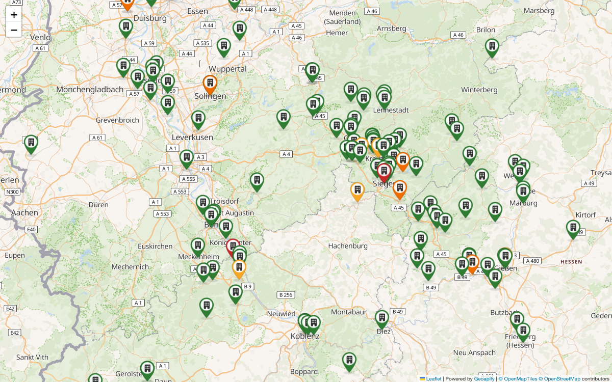

# Show Addresses on a Map in Python (Folium + Geoapify)

## Objective
Show geocoded addresses on an interactive map in Python. The script reads the results of the [Geoapify Geocoding API](https://apidocs.geoapify.com/docs/geocoding/forward-geocoding/) from an NDJSON file (for example, the output of the [geocode_addresses](../geocode_addresses) sample), puts every address on a [Folium](https://python-visualization.github.io/folium/) map with [Geoapify map tiles](https://apidocs.geoapify.com/docs/maps/map-tiles/), and colors each marker by geocoding confidence. Optionally, it clusters nearby markers and uses icons from the [Geoapify Marker Icon API](https://apidocs.geoapify.com/docs/icon/).

The flow: **address list → Geocoding API → NDJSON → map**.



## Requirements
- Python 3.9 or higher
- pip
- A Geoapify API key: register on [Geoapify MyProjects](https://myprojects.geoapify.com/), create a project and copy its API key. The Free plan includes 3,000 credits per day.

## Setup Instructions

### 1. Clone the Repository
```bash
git clone https://github.com/geoapify/maps-api-code-samples.git
cd maps-api-code-samples/python/show-addresses-on-a-map
```

### 2. Create a Virtual Environment (Optional)
```bash
python -m venv env
source env/bin/activate  # On Windows: env\Scripts\activate
```

### 3. Install Dependencies
```bash
pip install folium requests
```

## Running the Example

Map with default Folium markers:

```bash
python show_addresses.py --input addresses.ndjson --api-key=YOUR_API_KEY
```

Map with clustering and Geoapify markers, saved to `my_map.html`:

```bash
python show_addresses.py --input addresses.ndjson --output my_map.html --cluster --geoapify-markers --api-key=YOUR_API_KEY
```

The script saves the map as an HTML file and opens it in your browser. `addresses.ndjson` contains 213 Geocoding API results for addresses in Germany; 212 of them have coordinates, and one is a `{"error": "Not found"}` line that the script skips.

## Command-Line Arguments
| Argument             | Required | Description |
|----------------------|----------|-------------|
| `--input`            | Yes      | NDJSON file with geocoding results, one JSON object per line |
| `--api-key`          | Yes      | Geoapify API key, used for the map tiles and the marker icons |
| `--output`           | No       | Output HTML file (default: `map.html`) |
| `--cluster`          | No       | Group nearby markers into clusters |
| `--geoapify-markers` | No       | Use Geoapify Marker Icon API icons instead of the default Folium markers |

## Input Format (NDJSON)
One JSON object per line. The script uses `lat`, `lon`, `formatted` (or `address`) and `rank.confidence`, the fields of a Geoapify Geocoding API result. A line from `addresses.ndjson`, shortened:

```json
{"lat": 50.815728, "lon": 8.1043638, "formatted": "57234 Wilnsdorf, Germany", "result_type": "postcode", "rank": {"confidence": 0.3}}
```

Records without `lat` or `lon` are skipped and counted. A missing `rank.confidence` counts as 0.

## Marker Colors

| Confidence (`rank.confidence`) | Folium marker | Geoapify marker |
|-------------------------------|---------------|-----------------|
| 0.7 and above                 | green         | `#2e7d32`       |
| 0.5 to 0.7                    | beige         | `#f9a825`       |
| 0.25 to 0.5                   | orange        | `#ef6c00`       |
| below 0.25                    | red           | `#c62828`       |

Low confidence usually means the geocoder matched only part of the address (a street or a postcode instead of a building). Check those addresses before you use them.

## Code Explanation

### Geoapify map tiles

```python
BASE_MAP_TILE_URL = "https://maps.geoapify.com/v1/tile/{map_style}/{{z}}/{{x}}/{{y}}@2x.png?apiKey={api_key}"
```

`create_map()` adds this URL as a Folium `TileLayer` with the `osm-bright` style and the attribution "Powered by Geoapify | © OpenMapTiles © OpenStreetMap contributors". Other styles are listed in the [Map Tiles documentation](https://apidocs.geoapify.com/docs/maps/map-tiles/).

### Geoapify markers

```python
params = {
    'type': 'material',
    'icon': 'building',
    'iconType': 'awesome',
    'color': color,
    'scaleFactor': 2,  # sharp on high-density screens
    'apiKey': api_key,
}
icon_url = f"https://api.geoapify.com/v2/icon?{urlencode(params)}"
response = requests.head(icon_url, timeout=10)
```

The Marker Icon API returns a PNG marker. Its `Icon-Width`, `Icon-Height`, `Icon-Anchor-X` and `Icon-Anchor-Y` response headers give the display size and the anchor point, so the script makes one `HEAD` request per color and passes these values to `folium.CustomIcon`. The marker tip then sits exactly on the address. Try other shapes, icons and colors in the [Marker Icon API Playground](https://apidocs.geoapify.com/playground/icon/).

### Points, popups and bounds

For each record, `create_map()` picks the confidence color, adds a marker with a popup (the address and its confidence) to the map or to a `MarkerCluster`, and finally calls `fit_bounds()` with the south-west and north-east corners of all points, so every marker is visible.

## Attribution
The map shows the "Powered by Geoapify", "© OpenMapTiles" and "© OpenStreetMap contributors" attribution that the script adds. The `building` icon is from [Font Awesome](https://fontawesome.com/) (CC BY 4.0).

## Related
- [Python Geocoding Tutorial: From Address List to Saved Results](https://www.geoapify.com/tutorial/geocoding-python/)
- [geocode_addresses](../geocode_addresses): create the NDJSON file from an address list
- [Map Tiles documentation](https://apidocs.geoapify.com/docs/maps/map-tiles/)
- [Marker Icon API documentation](https://apidocs.geoapify.com/docs/icon/)

## License
MIT License
